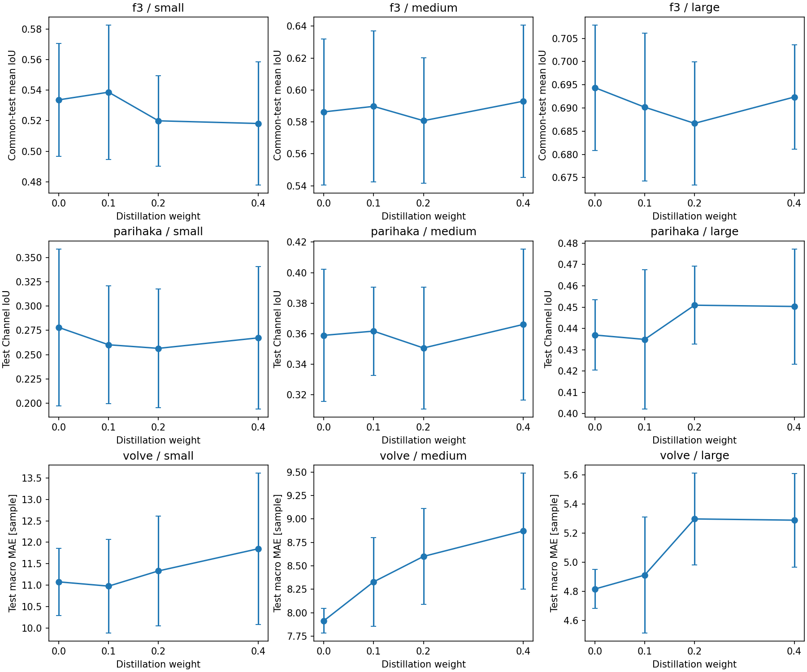

# HMM v2 特徴蒸留損失の感度解析

MAE初期化・K=[6,8,10]・整合性0.1の固定条件で、蒸留係数0 / 0.1 / 0.2 / 0.4を事前指定して比較しました。新規25 epoch学習9件、特徴抽出9件、下流学習135セルを完了し、既存0.2の3モデル・45セルを再利用しました。最終比較は180セルです。

5レイアウトの平均±標本標準偏差（ddof=1）を示します。F3は既存共通testのMean IoU、Parihakaはtest Channel IoU、Volveはtest macro MAE [sample]です。F3 validationは集計JSONの別データに保存し、曲線には混ぜていません。

| データ | 教師量 | 0 | 0.1 | 0.2 | 0.4 | 0の改善量 vs 0.2 | 0.1–0.4の変動幅 |
| --- | --- | ---: | ---: | ---: | ---: | ---: | ---: |
| f3 | small | 0.53364 ± 0.03686 | 0.53866 ± 0.04404 | 0.51991 ± 0.02966 | 0.51816 ± 0.04028 | +0.01373 | 0.02050 |
| f3 | medium | 0.58629 ± 0.04581 | 0.58975 ± 0.04737 | 0.58078 ± 0.03933 | 0.59298 ± 0.04780 | +0.00551 | 0.01221 |
| f3 | large | 0.69438 ± 0.01351 | 0.69017 ± 0.01590 | 0.68668 ± 0.01328 | 0.69235 ± 0.01122 | +0.00770 | 0.00567 |
| parihaka | small | 0.27796 ± 0.08078 | 0.26012 ± 0.06059 | 0.25642 ± 0.06110 | 0.26722 ± 0.07320 | +0.02154 | 0.01080 |
| parihaka | medium | 0.35894 ± 0.04315 | 0.36169 ± 0.02889 | 0.35066 ± 0.03996 | 0.36607 ± 0.04947 | +0.00828 | 0.01541 |
| parihaka | large | 0.43692 ± 0.01648 | 0.43486 ± 0.03266 | 0.45091 ± 0.01829 | 0.45032 ± 0.02700 | -0.01399 | 0.01605 |
| volve | small | 11.07524 ± 0.78562 | 10.97518 ± 1.09469 | 11.33060 ± 1.28188 | 11.84738 ± 1.77173 | +0.25536 | 0.87220 |
| volve | medium | 7.91298 ± 0.13027 | 8.32855 ± 0.47298 | 8.59990 ± 0.51235 | 8.87076 ± 0.61980 | +0.68692 | 0.54221 |
| volve | large | 4.81497 ± 0.13417 | 4.91111 ± 0.39866 | 5.29754 ± 0.31668 | 5.28904 ± 0.32225 | +0.48256 | 0.38643 |

改善量はIoUで候補−0.2、Volve MAEで0.2−候補です。各layoutの値と対応差分は[cells.csv](cells.csv)、36群の平均・標本標準偏差は[comparison.csv](comparison.csv)にあります。

F3 validation: [f3_validation.csv](f3_validation.csv).

固定cropでの25 epoch後のteacher平均cosine距離：

| データ | 0 | 0.1 | 0.2 | 0.4 |
| --- | ---: | ---: | ---: | ---: |
| f3 | 0.186940 | 0.033790 | 0.024095 | 0.017137 |
| parihaka | 0.260048 | 0.034937 | 0.020998 | 0.012568 |
| volve | 0.243748 | 0.021339 | 0.014217 | 0.009874 |

距離は固定teacherとのcosine距離で、蒸留係数0でも実測します。損失寄与0と表現差0を区別しています。新規9モデルは開始時と全epoch終了時の固定crop評価を保存しました。再利用0.2は中間checkpointが残っていないため固定crop評価は開始時・最終epochのみです。既存の各epoch学習crop距離は別列に保存しています。全診断値は[feature_diagnostics.csv](feature_diagnostics.csv)にあります。距離の大小だけから下流性能や地質情報の保持を結論しません。

各係数・データセットにつきencoder学習はseed 42の1回です。5レイアウトは5回のencoder学習ではなく、包含関係のある3教師量も独立反復ではありません。有意差検定による係数選択は行っていません。F3は同一調査地域内transductive・下流ラベルholdoutで、完全な空間振幅holdoutではありません。test結果による正本係数・選択済みcheckpointの変更はありません。

既存v1蒸留0.1対0.2は[135組](auxiliary_v1_pairs.csv)、v2整合性0.1対0はK6810/K468を分けた[270組](auxiliary_v2_consistency_pairs.csv)を整理しました。[補助集計](auxiliary_comparison.csv)ではMAE・現行asymmetric Barlow Twins・randomを区別しています。v1値は新規v2曲線に含めません。F3 v1にはworker数などの実行条件差があり、完全に同じ学習乱数系列の比較とは扱いません。

公開レビュー用ファイルは10点のみです。原成果物・集計JSON・checkpoint・再開履歴はartifactsに保持し、このreportをパイプライン入力には使用しません。[出典hash](provenance.json)、[実験定義と再開方法](../../experiments/hmm_v2/distillation_sensitivity_v1/README.md)、[実装・検証記録](../../experiments/hmm_v2/distillation_sensitivity_v1/VALIDATION.md)を参照してください。
