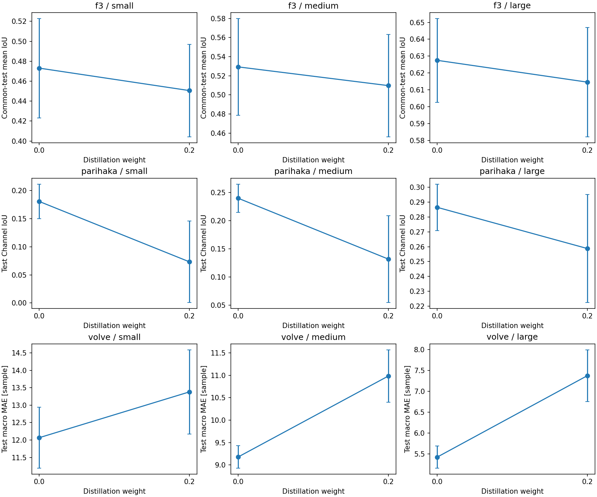

# HMM v2 Random初期化：蒸留0と0.2の比較

Random初期化・K=[6,8,10]・整合性0.1を固定し、蒸留0の25 epoch学習3件、特徴抽出3件、下流学習45セルを完了しました。既存0.2の3モデル・45セルを再利用し、計90セルを比較しています。係数の選び直しは行いません。

F3は共通test Mean IoU、Parihakaはtest Channel IoU、Volveはtest macro MAE [sample]です。5レイアウトの平均±標本標準偏差（ddof=1）を示します。改善量はIoUで候補−0.2、MAEで0.2−候補とし、正が改善です。

| データ | 教師量 | 蒸留0 | 既存0.2 | 対応改善量（平均±標本SD） |
| --- | --- | ---: | ---: | ---: |
| f3 | small | 0.47308 ± 0.04984 | 0.45056 ± 0.04639 | +0.02252 ± 0.01786 |
| f3 | medium | 0.52927 ± 0.05073 | 0.50967 ± 0.05361 | +0.01960 ± 0.02018 |
| f3 | large | 0.62751 ± 0.02484 | 0.61458 ± 0.03241 | +0.01292 ± 0.01349 |
| parihaka | small | 0.18056 ± 0.03089 | 0.07315 ± 0.07235 | +0.10740 ± 0.08202 |
| parihaka | medium | 0.23956 ± 0.02514 | 0.13163 ± 0.07693 | +0.10793 ± 0.10118 |
| parihaka | large | 0.28650 ± 0.01566 | 0.25875 ± 0.03633 | +0.02776 ± 0.03409 |
| volve | small | 12.06778 ± 0.87384 | 13.38100 ± 1.20797 | +1.31322 ± 0.74187 |
| volve | medium | 9.17937 ± 0.25073 | 10.98460 ± 0.58504 | +1.80524 ± 0.65390 |
| volve | large | 5.42582 ± 0.26556 | 7.37716 ± 0.61994 | +1.95134 ± 0.38991 |

各layoutの値と対応差分は[cells.csv](cells.csv)、全18群の集計は[comparison.csv](comparison.csv)、F3 validationは別表[f3_validation.csv](f3_validation.csv)に保存しています。

固定評価cropでの最終teacher平均cosine距離：

| データ | 蒸留0 | 既存0.2 |
| --- | ---: | ---: |
| f3 | 0.433813 | 0.018673 |
| parihaka | 0.313648 | 0.012539 |
| volve | 0.464374 | 0.011486 |

生値・重み付き損失、ヘッド別使用率エントロピー、ヘッド間整合性、固定crop距離は[feature_diagnostics.csv](feature_diagnostics.csv)に保存しています。新規0は開始時と各epoch終了時、既存0.2は保持checkpointから開始時と最終時を測定しました。既存0.2の中間固定crop値はcheckpoint未保存のため回収できません。

Random自身の初期checkpointをstudentと固定teacherに使い、Random固有のHMM疑似ラベルを係数間で固定しています。最上位1 blockだけを更新します。蒸留は初期ランダム写像からの変化を抑える制約です。距離だけで下流性能や地質情報の保持を結論しません。

継続学習seedは42の1回です。5レイアウトはencoder学習の5反復ではなく、3教師量も包含関係にあります。F3は同一調査地域内transductiveなラベルholdoutです。正本係数・選択済みcheckpointは変更していません。

[MAEの結果](../hmm_v2_distillation_sensitivity_v1/README.md)との比較では、初期表現に加えてteacherとHMM targetも異なります。初期表現だけの効果とは扱いません。

公開ファイルは7点に限定しています。[出典hash](provenance.json)、[実験定義・再開方法](../../experiments/hmm_v2/random_distillation_ablation_v1/README.md)を参照してください。完全な集計JSONと実行履歴はartifactsに保存しています。
