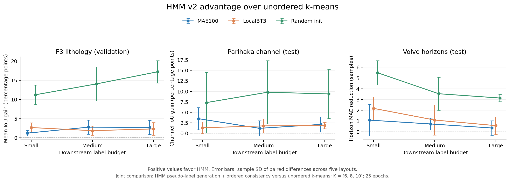

# Unordered k-means versus stratigraphic HMM v2

All nine 25-epoch training conditions and 135 downstream cells completed on
2026-10-30. The comparison contains F3 lithology, Parihaka channel segmentation,
and Volve horizon interpretation, each with MAE100, asymmetric LocalBT3, and
random initialization. Five matched layouts are evaluated at each of the
small, medium, and large label budgets.

## Findings

The five-layout mean of the primary metric favors HMM v2 in all 27
survey/source/budget conditions. The largest differences occur with random
initialization. At the large label budget, HMM improves F3 Mean IoU by
17.22 percentage points and Parihaka channel IoU by 9.38 percentage points,
and reduces Volve horizon MAE by 3.14 samples for that source family.

The secondary metrics favor HMM in 25 of 27 conditions. For Volve's medium
budget, k-means has higher macro within-two-samples accuracy for MAE100
(48.66% versus 45.33%) and LocalBT3 (40.47% versus 39.91%), even though HMM
has lower macro MAE in both conditions.

These are descriptive paired results over five layouts. The error bars below
are sample standard deviations of paired differences, not confidence intervals.
No statistical-significance claim is made, and the nested label budgets are
not independent replicates.

## Comparison contract

The control uses fixed MiniBatchKMeans labels at K=[6,8,10] and no ordered
cross-head consistency. The matched HMM v2 condition uses ordered HMM targets
and consistency weight 0.1. Prototype/usage/distillation weights, original
student/teacher parents, top-one-block continuation, preprocessing, edge-excluded
valid support, learning rates, batch sizes, seed 42, and the 25-epoch budget
are matched. All arms use the completed epoch-25 encoder.

This is the joint ablation of HMM target generation and ordered cross-head
consistency. It evaluates the complete stratigraphic learning design; it does
not isolate HMM decoding alone. These are same-survey evaluations and do not
establish transfer to an unseen survey.

Definitions and execution details are in the
[study runbook](../../experiments/kmeans/kmeans_k6810_multi_source_v1/README.md),
with [validation and recovery evidence](../../experiments/kmeans/kmeans_k6810_multi_source_v1/VALIDATION.md).

## Primary metrics

F3 uses validation Mean IoU; Parihaka uses test channel IoU. Both are fractions
on [0,1], with higher values better. Volve uses test macro horizon MAE in samples,
with lower values better. Each table entry is the mean over five layouts.
Differences below are **k-means minus HMM**; negative IoU differences and positive
MAE differences favor HMM. The final column gives the paired mean difference
and its sample standard deviation.

| Survey | Source | Size | k-means | HMM v2 | Difference ± sample SD |
| --- | --- | --- | ---: | ---: | ---: |
| f3 | mae | small | 0.501001 | 0.513233 | -0.012231 ± 0.007312 |
| f3 | mae | medium | 0.550445 | 0.578242 | -0.027797 ± 0.018497 |
| f3 | mae | large | 0.654079 | 0.681257 | -0.027178 ± 0.018444 |
| f3 | local_bt | small | 0.355995 | 0.382755 | -0.026761 ± 0.012741 |
| f3 | local_bt | medium | 0.417536 | 0.436182 | -0.018645 ± 0.012249 |
| f3 | local_bt | large | 0.493083 | 0.516336 | -0.023253 ± 0.016349 |
| f3 | random | small | 0.351958 | 0.464155 | -0.112197 ± 0.025218 |
| f3 | random | medium | 0.392136 | 0.532708 | -0.140572 ± 0.044301 |
| f3 | random | large | 0.446248 | 0.618404 | -0.172155 ± 0.029094 |
| parihaka | mae | small | 0.221707 | 0.256420 | -0.034713 ± 0.026610 |
| parihaka | mae | medium | 0.338979 | 0.350659 | -0.011680 ± 0.018179 |
| parihaka | mae | large | 0.429917 | 0.450908 | -0.020991 ± 0.018304 |
| parihaka | local_bt | small | 0.092974 | 0.106009 | -0.013035 ± 0.014092 |
| parihaka | local_bt | medium | 0.145742 | 0.163221 | -0.017479 ± 0.016970 |
| parihaka | local_bt | large | 0.211966 | 0.230497 | -0.018531 ± 0.007551 |
| parihaka | random | small | 0.000020 | 0.073152 | -0.073132 ± 0.072318 |
| parihaka | random | medium | 0.033753 | 0.131634 | -0.097881 ± 0.075470 |
| parihaka | random | large | 0.164954 | 0.258746 | -0.093792 ± 0.058499 |
| volve | mae | small | 12.408850 | 11.330603 | 1.078247 ± 1.471096 |
| volve | mae | medium | 9.321088 | 8.599899 | 0.721189 ± 0.552416 |
| volve | mae | large | 5.645755 | 5.297539 | 0.348216 ± 0.682633 |
| volve | local_bt | small | 17.050451 | 14.875486 | 2.174965 ± 1.070714 |
| volve | local_bt | medium | 13.970737 | 12.883323 | 1.087414 ± 1.397459 |
| volve | local_bt | large | 10.301129 | 9.735304 | 0.565826 ± 0.818855 |
| volve | random | small | 18.874560 | 13.380997 | 5.493564 ± 1.129058 |
| volve | random | medium | 14.522923 | 10.984605 | 3.538319 ± 1.539518 |
| volve | random | large | 10.515960 | 7.377156 | 3.138803 ± 0.332335 |

## Review files and provenance

- [comparison.csv](comparison.csv): all 27 conditions, primary/secondary means,
  sample standard deviations, and paired differences. Line endings are normalized
  to LF; all CSV records retain their original content.
- [hmm_advantage_by_source_and_budget.png](hmm_advantage_by_source_and_budget.png):
  the primary-metric differences across sources and budgets.
- [provenance.json](provenance.json): relative source artifact references and
  SHA-256 identities for the study matrix and review files.

The complete audited outputs remain under
`$SEIS_SSL_CLUSTER_ARTIFACT_ROOT/studies/kmeans/kmeans_k6810_multi_source_v1/`.
The large audit JSON, trained models, pseudo-label arrays, and embeddings remain
in artifacts. This directory is for human review and is never a pipeline input.
